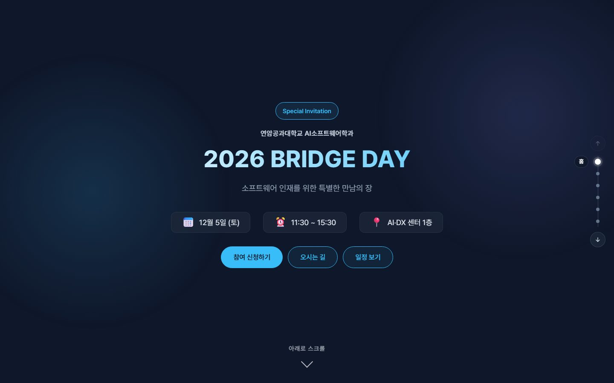
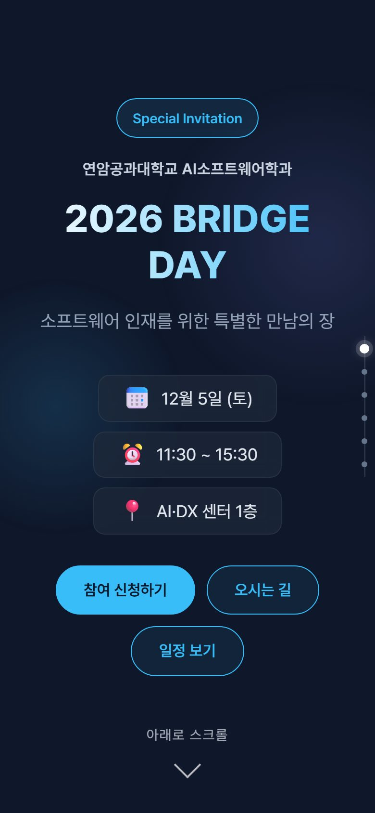
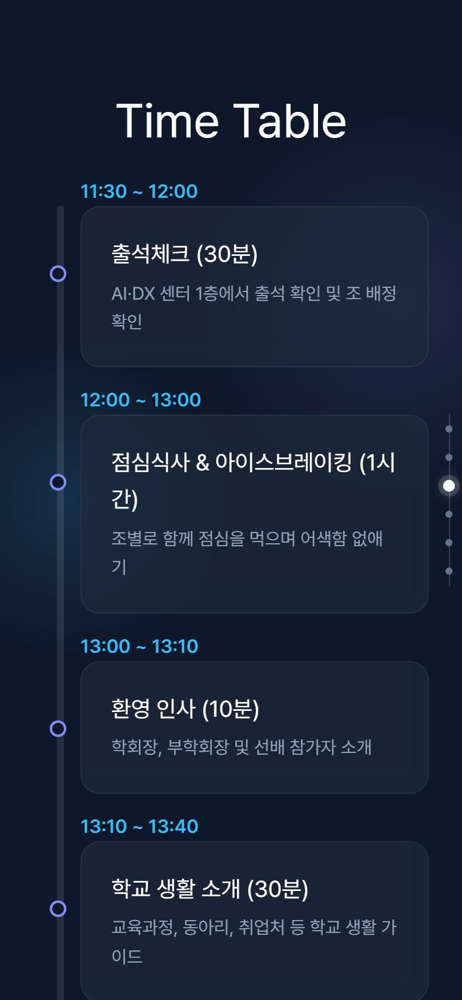
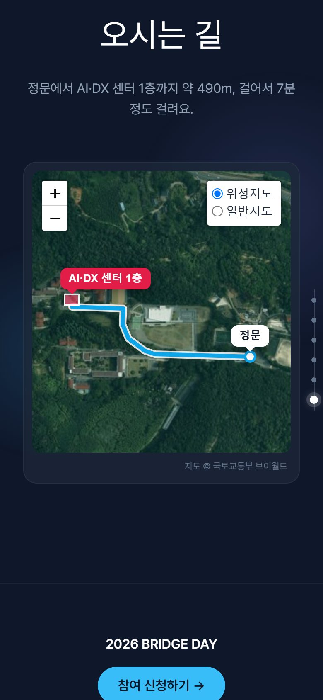
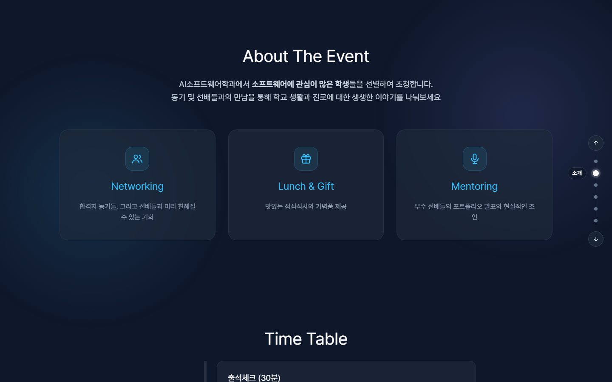
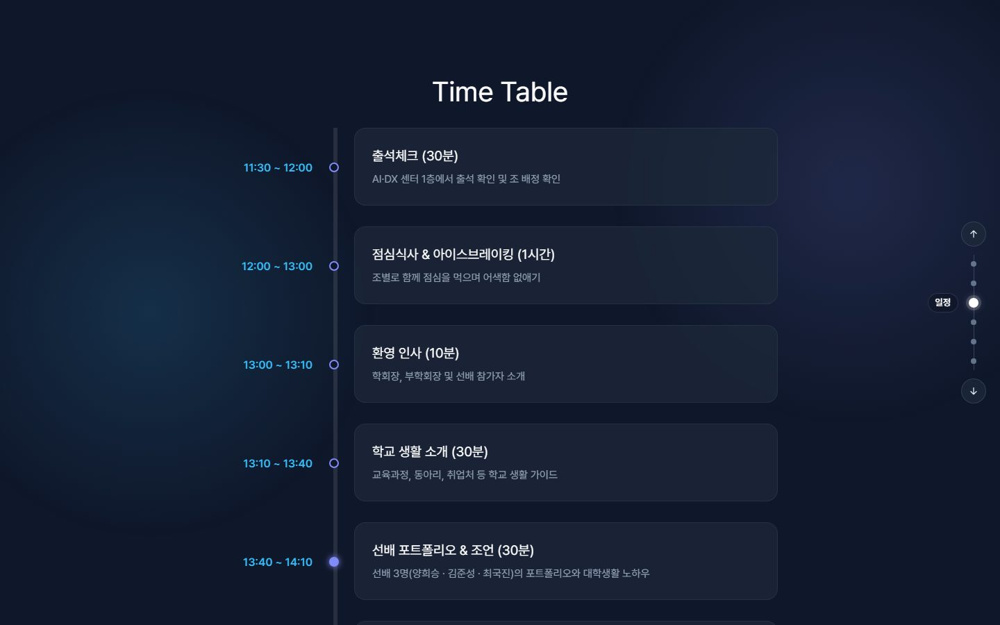
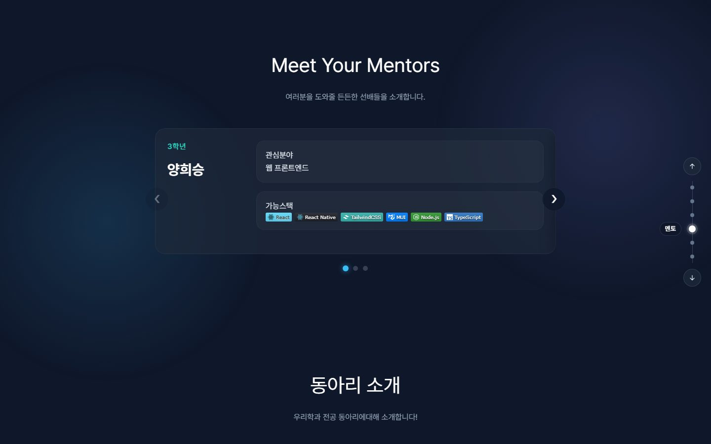
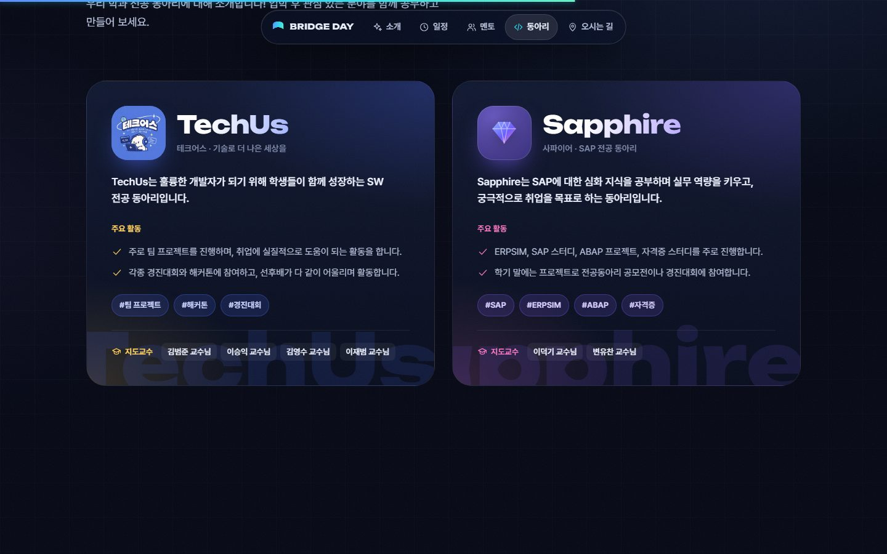
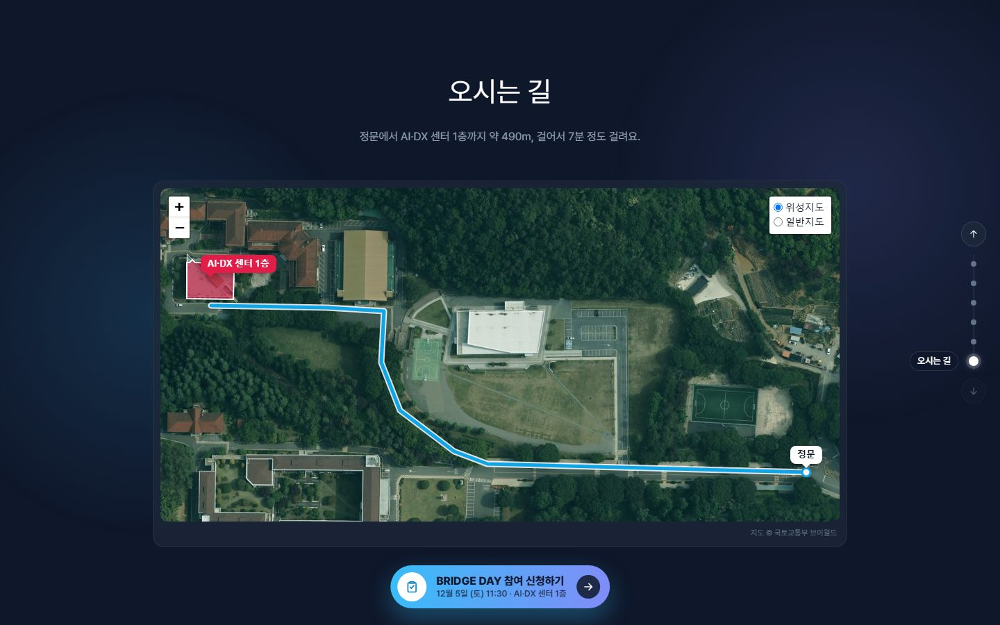

# 🌉 2026 BRIDGE DAY – 행사 안내 웹사이트

> **소프트웨어 인재를 위한 특별한 만남의 장**  
> 연암공과대학교 AI소프트웨어학과 BRIDGE DAY 초청 행사를 소개하는 랜딩 페이지입니다.  
> **참가 대상 학생들에게 공유할 공식 안내 URL**에 해당합니다.

<p align="center">
  
</p>

---

## 🔗 배포 URL

> 📎 **참가자 안내용 URL:** https://yc-aisw.github.io/bridge_day/

GitHub Pages에서 제공하는 프론트엔드 전용 사이트입니다. 별도 백엔드 서버는 필요하지 않습니다.

### 자동 배포

- `main` 브랜치에 푸시하면 GitHub Actions가 의존성 설치, 빌드, GitHub Pages 배포를 실행합니다.
- 워크플로: [`.github/workflows/deploy.yml`](./.github/workflows/deploy.yml)
- 배포 상태: [GitHub Actions](https://github.com/YC-AISW/bridge_day/actions/workflows/deploy.yml)
- 수동 재배포: Actions → Deploy to GitHub Pages → Run workflow → `main`
- 저장소 설정: Settings → Pages → Build and deployment → Source: **GitHub Actions**

`vite.config.ts`의 `base`는 GitHub Pages 경로에 맞춰 `/bridge_day/`로 설정되어 있습니다.

### 로컬 실행 및 빌드

```bash
npm ci
npm run dev
```

```bash
npm run build
npm run preview
```

빌드 결과는 `dist/`에 생성됩니다. 미리보기에서는 `/bridge_day/` 경로로 접속합니다.

### 지도 API 키 (브이월드)

오시는 길 지도는 국토교통부 [브이월드](https://www.vworld.kr) 지도를 씁니다. 키가 없으면 Esri 위성사진(2020년, 연암미래관이 없음)과 OpenStreetMap으로 대신 보여 줍니다.

- **로컬:** 저장소 루트에 `.env.local`을 만들고 `VITE_VWORLD_KEY=키`를 적습니다. (git에 올라가지 않습니다)
- **배포:** 저장소 Settings → Secrets and variables → Actions에 `VITE_VWORLD_KEY` 시크릿을 등록합니다. 로컬에 `.env.local`이 있으면 아래 명령 한 줄로 등록할 수 있습니다.

  ```bash
  gh secret set -f .env.local -R YC-AISW/bridge_day
  ```

- 지도 키는 브라우저에서 타일을 불러올 때 쓰이므로 배포된 페이지의 코드 안에 들어갑니다. 브이월드에서 키의 사용 도메인을 `yc-aisw.github.io`로 제한해 두면 안전합니다.

---

## 📅 행사 개요 (2026)

- **행사명:** 2026 BRIDGE DAY
- **주최:** 연암공과대학교 AI소프트웨어학과
- **일시:** 12월 5일 (토) 11:30 ~ 15:30
- **참여 신청:** https://prairie-lint-d34.notion.site/43223e729dac4c9d9928bcd7e087a0dc
- **장소:** AI·DX 센터 1층 (정문에서 도보 약 7분)
- **대상:** 소프트웨어에 관심이 많은 초청 학생
- **주요 내용:** 점심 · 아이스브레이킹 · 학교 생활 소개 · 선배 포트폴리오 발표 · AI·DX 센터 체험 · 선배 프로젝트 체험

---

## ✏️ 내용 수정하기

문구와 일정은 모두 [`src/data.ts`](./src/data.ts) 한 파일에 있습니다. 화면 코드는 고치지 않아도 됩니다.

| 바꿀 내용 | 위치 |
| --- | --- |
| 연도 · 날짜 · 시간 · 장소 · 학과명 | `event` — 날짜를 `"2026-12-05"`처럼 넣으면 "12월 5일 (토)"처럼 요일이 자동으로 붙습니다. |
| 행사 특징 카드 | `features` — 아이콘은 `network` · `lunch` · `mentor` 중에서 고릅니다. |
| 타임테이블 | `timeline` — 시간(`time`), 제목(진행 시간 포함), 설명, 강조(`type`) |
| 멘토 | `mentors` — 기술 스택은 shields.io 배지 URL. 비워 둔 관심 분야는 "소개 준비 중"으로 표시됩니다. |
| 전공 동아리 | `clubs` — [학과 홈페이지 전공동아리](https://www.yc.ac.kr/smartsw/major-clubs.do) 기준. 동아리장을 비워 두면 표시하지 않습니다. |
| 문의 전화 | `src/components/Footer.tsx` |
| 지도 경로 · 목적지 | `src/campusRoute.ts` (위도, 경도) |

---

## 🗺️ 오시는 길 지도

- 브이월드 실제 지도(2D) 위에 정문에서 AI·DX 센터까지 가는 길과 목적지 건물만 표시합니다. 오른쪽 위에서 위성지도와 일반지도를 바꿀 수 있습니다.
- 지도 라이브러리는 [Leaflet](https://leafletjs.com)이고, "오시는 길" 근처까지 스크롤했을 때만 불러와서 첫 화면 로딩에는 영향이 없습니다.
- 휴대폰에서는 페이지 스크롤이 지도에 막히지 않도록 한 손가락 끌기를 끄고, 두 손가락 확대·이동만 됩니다.
- 경로는 OpenStreetMap 캠퍼스 도로 데이터를 따라 그렸고, 위성사진·정문 사진으로 정문 위치를 확인했습니다. 정문에서 연암미래관 앞 갈림길까지가 오르막입니다.
- 출처: 지도 © 국토교통부 브이월드, 건물 윤곽 국토교통부 도로명주소 건물, 도로 © OpenStreetMap contributors (ODbL)

---

## 🖥 화면 구성

| 첫 화면 (모바일) | 일정 (모바일) | 오시는 길 (모바일) |
| :---: | :---: | :---: |
|  |  |  |

### 📘 About The Event

<p align="center"></p>

### 🕒 Time Table

<p align="center"></p>

### 👨‍🏫 Meet Your Mentors

<p align="center"></p>

### 🏫 동아리 소개

<p align="center"></p>

### 🗺️ 오시는 길

<p align="center"></p>

---

## 🛠 기술 스택 (웹 구현)

- React
- Vite
- TypeScript
- Tailwind CSS (기본 스타일 초기화)
- Framer Motion
- Leaflet (오시는 길 지도)
- 글꼴: Pretendard (npm 패키지로 함께 배포)

디자인은 2025 BRIDGE DAY 때 만든 화면을 바탕으로, 2026년 내용 · 오시는 길 지도 · 오른쪽 섹션 바로가기를 더했습니다.
